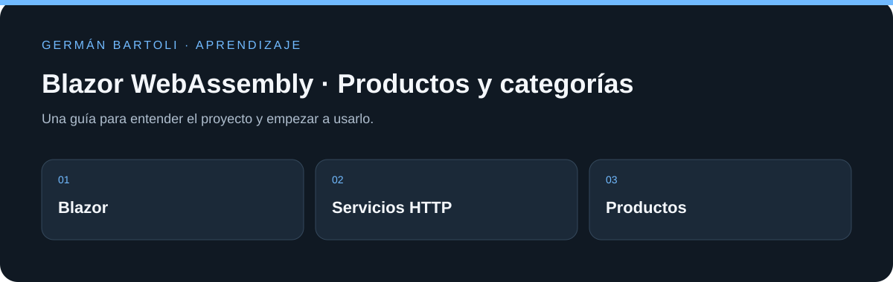

# Blazor WebAssembly · Productos y categorías

**Aplicación de práctica con Blazor WebAssembly que utiliza servicios de productos y categorías y una API externa.**

[Empezar](#primeros-pasos) · [Mapa del repositorio](#mapa-del-repositorio) · [Autoría](#autoría-de-esta-documentación)

*Esquema de orientación; no representa una captura de la aplicación.*

## Primeros pasos

1. Abrí `BlazorAppVisualStudio/BlazorAppVisualStudio.sln`.
2. Revisá `Services/ProductService.cs` y `Services/CategoryService.cs` dentro del proyecto para conocer la API utilizada.
3. Ejecutá con un entorno compatible con `net6.0`. La disponibilidad y los datos dependen también del servicio externo.

## Entorno de aprendizaje

Este repositorio conserva ejercicios y versiones de su etapa de estudio. Revisá los archivos de proyecto para preparar el SDK, runtime o servidor correspondiente; esta actualización del README no migra dependencias ni acredita una ejecución reciente de todos los ejemplos.

## Referencia y detalles

https://github.com/platzi/curso-aplicaciones-web-blazor/tree/1-ciclodevidayparametros

https://platzi.com/cursos/blazor-webassembly/

https://fakeapi.platzi.com/en/rest/products

https://github.com/Blazored/Toast#blazor-webassembly

## Mapa del repositorio

- [BlazorAppVisualStudio/BlazorAppVisualStudio.sln](<BlazorAppVisualStudio/BlazorAppVisualStudio.sln>)
- [BlazorAppVisualStudio/BlazorAppVisualStudio/BlazorAppVisualStudio.csproj](<BlazorAppVisualStudio/BlazorAppVisualStudio/BlazorAppVisualStudio.csproj>)
- [BlazorAppVisualStudio/BlazorAppVisualStudio/Program.cs](<BlazorAppVisualStudio/BlazorAppVisualStudio/Program.cs>)
- [BlazorAppVisualStudio/BlazorAppVisualStudio/wwwroot/index.html](<BlazorAppVisualStudio/BlazorAppVisualStudio/wwwroot/index.html>)
- [docs/PUBLICACION.md](<docs/PUBLICACION.md>)

## Autoría de esta documentación

Repositorio mantenido por [Germán Bartoli](https://github.com/GermanBartoli). Guía revisada y actualizada con **Codex**, coautor de esta actualización documental. Los autores, colaboradores, licencias y recursos de terceros conservan sus créditos originales.

Los commits de esta revisión incluyen `Co-authored-by: Codex <noreply@openai.com>`; esta atribución no modifica la autoría del historial anterior.
